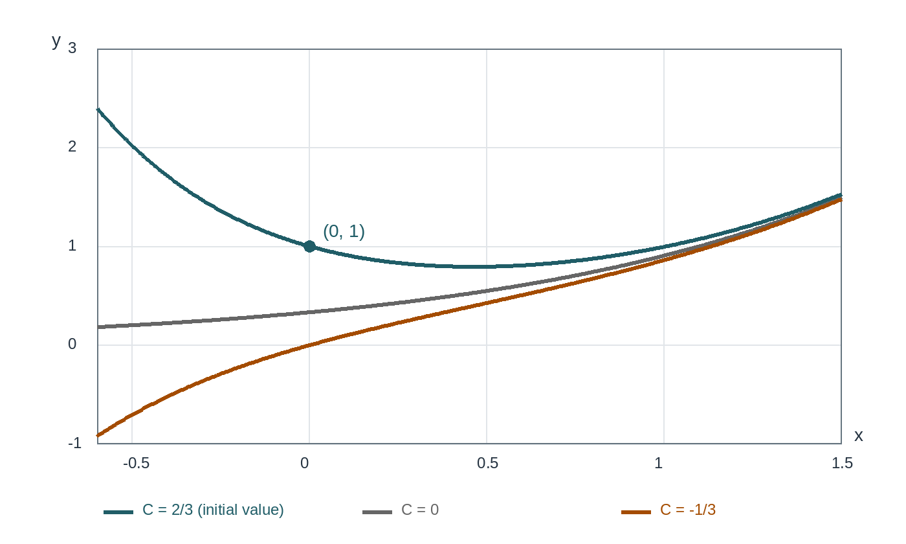

# Why integrating factors work {#sec-integrating-factors}

An integrating factor is a way of recognising the product rule in disguise.
The aim is to turn two terms involving an unknown function into **one exact
derivative**. You need the product rule and elementary integration to follow
this chapter.

## Start with the linear form

A first-order linear differential equation has the standard form

$$
y' + p(x)y = q(x).
$$ {#eq-linear}

Here $y=y(x)$ is unknown, while $p$ and $q$ are given functions; $y'$ means
$\mathrm{d}y/\mathrm{d}x$. The word *linear* means that $y$ and $y'$ appear to
the first power, with coefficients depending only on $x$.

Work on an interval $I$ where $p$ and $q$ are continuous. If the original
equation is $a(x)y'+b(x)y=c(x)$, first divide by $a(x)$ on an interval where
$a(x)\ne0$. This identifies $p=b/a$ and $q=c/a$; it can also restrict the domain.

## Ask the product rule for help

For a differentiable multiplier $\mu(x)$, the product rule says

$$
(\mu y)'=\mu y'+\mu' y.
$$ {#eq-product-rule}

Multiplying @eq-linear by $\mu$ gives
$\mu y'+\mu p y=\mu q$. Compare its left side with @eq-product-rule:
the coefficient of $y'$ already matches. To match the coefficient of $y$ as
well, choose

$$
\mu'=p\mu.
$$ {#eq-factor-condition}

Choose an antiderivative $P$ of $p$ on $I$. Then

$$
\mu(x)=e^{P(x)}=e^{\int p(x)\,\mathrm{d}x}
$$ {#eq-integrating-factor}

works because the chain rule gives $\mu'=P'e^P=p\mu$. This choice is strictly
positive, so dividing by it will be safe throughout $I$.[^scale]

[^scale]: The indefinite integral in the exponent means any one antiderivative.
    Adding a constant rescales $\mu$ by a nonzero constant and does not change
    the final family of solutions. A negative nonzero multiple also works.

::: {.callout-note title="The decisive equality"}
Using @eq-factor-condition, multiplication gives exactly

$$
\underbrace{\mu y'+\mu p y}_{\mu y'+\mu' y}
  =(\mu y)'=\mu q.
$$ {#eq-exact-derivative}

The multiplier has made the coefficient of $y$ into the derivative of the
coefficient of $y'$. That is why the product rule applies.
:::

This is the standard integrating-factor method discussed in
@openstax-linear. The explanation and examples here develop the coefficient
matching directly.

## Integrate and recover the unknown

Let $F$ be one antiderivative of $\mu q$. Integrating @eq-exact-derivative gives
$\mu y=F+C$, and hence

$$
y(x)=\frac{F(x)+C}{\mu(x)}.
$$ {#eq-general-solution}

The arbitrary real constant $C$ is essential: before an initial value is given,
we have a family of solutions. If $y(x_0)=y_0$ with $x_0\in I$, an equivalent
formula that incorporates the initial condition is

$$
y(x)=\frac{\mu(x_0)y_0+\int_{x_0}^{x}\mu(t)q(t)\,\mathrm{d}t}{\mu(x)}.
$$ {#eq-initial-value}

Differentiating $\mu y=F+C$ recovers the multiplied equation, and division by
$\mu\ne0$ recovers the original equation. So the calculation both finds
solutions and verifies that every expression in @eq-general-solution works.

## Worked example: an exponential input

Solve $y'+2y=e^x$ with $y(0)=1$ on $\mathbb R$.

1. **Identify the coefficients.** Here $p=2$, $q=e^x$, and both are continuous
   for every real $x$.
2. **Choose the multiplier.** An antiderivative of $2$ is $2x$, so
   $\mu=e^{2x}$.
3. **Multiply every term.** We obtain
   $$e^{2x}y'+2e^{2x}y=e^{3x},\qquad (e^{2x}y)'=e^{3x}.$$
4. **Integrate and divide.** This gives
   $$e^{2x}y=\tfrac13 e^{3x}+C,\qquad
     y=\tfrac13 e^x+Ce^{-2x}.$$
5. **Use the initial value.** At $x=0$, $1=1/3+C$, so $C=2/3$. Therefore
   $$y=\tfrac13 e^x+\tfrac23 e^{-2x}.$$

### Check by substitution

Differentiating the final answer gives $y'=\tfrac13 e^x-\tfrac43 e^{-2x}$.
Consequently,

$$
y'+2y=\left(\tfrac13+\tfrac23\right)e^x
       +\left(-\tfrac43+\tfrac43\right)e^{-2x}=e^x,
$$

and $y(0)=1/3+2/3=1$, as required. @fig-solution-family shows how the initial
value selects one curve from the general family.

{#fig-solution-family fig-alt="Three solution curves for y prime plus 2y equals e to x. The curve with C equal to two thirds passes through the marked point (0,1); curves with C equal to zero and minus one third do not." width=90%}

## Domain checks and common mistakes

Continuity on an interval is a convenient sufficient assumption for this
argument, not a claim that every equation with a discontinuous coefficient is
unsolvable. Do not carry a solution across a singular coefficient without
checking the original problem.

| Check | Why it matters |
|:--|:--|
| Put the equation in standard form first. | The exponent uses the coefficient of $y$ **after** dividing by the coefficient of $y'$. |
| Use $e^{\int p\,\mathrm{d}x}$, including the sign of $p$. | It must satisfy $\mu'=p\mu$, not $\mu'=-p\mu$. |
| Multiply the right side too. | The new equation is $(\mu y)'=\mu q$, not $(\mu y)'=q$. |
| Keep $C$ after the second integration. | Dropping it loses all but one solution. |
| Divide by $\mu$ at the end. | The integral gives $\mu y$, rather than $y$. |

For example, $p(x)=1/x$ requires an interval avoiding zero. On either side of
zero, $e^{\log|x|}=|x|$ is an integrating factor. Multiplying it by a nonzero
constant on that interval can give the more convenient factor $x$.

## Exercises {#sec-exercises}

Try these before reading the solutions. In each case, show the product
 derivative and check the result in the original equation.

1. Solve $y'-y=2$ with $y(0)=0$ on $\mathbb R$.
2. Solve $y'+y/x=x$ with $y(1)=2$ on $x>0$. Explain the domain restriction.

## Solutions {#sec-solutions}

### Exercise 1

Here $\mu=e^{-x}$, so $(e^{-x}y)'=2e^{-x}$. Integration gives
$e^{-x}y=-2e^{-x}+C$, hence $y=-2+Ce^x$. The initial value gives $C=2$:
$y=2e^x-2$. Its derivative is $2e^x$, so $y'-y=2$, and $y(0)=0$.

### Exercise 2

On $x>0$, choose $\mu=e^{\log x}=x$. Then $(xy)'=x^2$, so
$xy=x^3/3+C$ and $y=x^2/3+C/x$. Since $y(1)=2$, $C=5/3$:

$$y=\frac{x^2}{3}+\frac{5}{3x}.$$

Checking gives $y'=2x/3-5/(3x^2)$ and $y/x=x/3+5/(3x^2)$, whose sum is $x$.
At $x=1$ the value is $2$. The coefficient $1/x$ is undefined at zero; the
interval containing the initial point is $(0,\infty)$, not all of $\mathbb R$.
